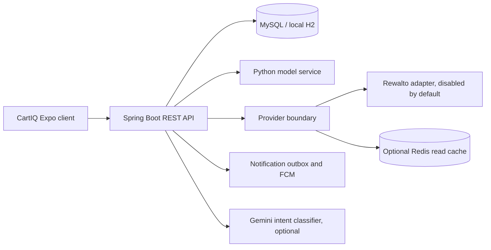
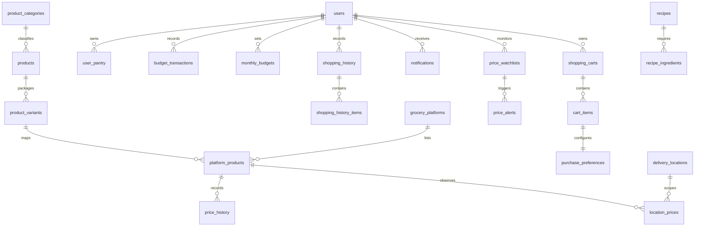

# Architecture and data ownership

The existing Expo/React Native client remains the primary application, as requested. A Vite migration was not performed. React Context and the teammate's navigation/styles are retained; web analytics use Recharts and native screens have compatible chart summaries.

Controllers expose DTOs, never password-bearing JPA entities. Spring Data JPA handles account lifecycle. Parameterized JDBC queries handle catalogue joins, transactional cart workflows and aggregate reporting. Flyway owns schema creation; Hibernate validates the mapped account entity and does not generate tables.

Core relations:

The migrations also include profiles/preferences, platform locations, replenishment, saved products, refresh tokens, device tokens, manually verified provider mappings and email-change requests. Foreign keys, unique keys, ownership predicates, timestamps and lookup indexes are defined in SQL. Product removal archives its canonical product and retains historical records.

Money is stored in integer paise. Quantities use normalized grams, millilitres or pieces. Package identity includes canonical product, amount and unit; provider matching also checks a manually reviewed retailer SKU, brand, title and parsed pack. Missing prices/stock/fees remain unknown.

The basket optimizer evaluates complete single-store baskets and split assignments. It includes configured minimum orders and fee thresholds, and preserves required quantities. Search is bounded at 250,000 nodes; if truncated, the result explicitly states it is the best evaluated basket rather than a proven global minimum. Live fees must be verified before the result is considered feasible.

Access JWTs last 30 minutes. Web refresh credentials use an HttpOnly, SameSite=Strict cookie and are rotated, hashed at rest and expired after 30 days. Logout/password/email changes revoke sessions through the user's session version. Native token storage uses SecureStore. CORS uses explicit origins, credentials stay server-side, authentication requests are rate-limited, and public registration cannot supply an administrator role.

Private carts, bookmarks, pantry, budgets, watches, notifications and purchase history are scoped to the authenticated subject. Device caches, checkout attempts and addresses use separate account keys. Guest data is separate and is not silently merged into a signed-in account.

Threshold evaluation runs in Spring Boot. Notification records have unique event keys; price events use observed state transitions. Sample events stay in-app. Real FCM transport still needs credentials and device registration. Push delivery is not guaranteed exactly once across network uncertainty; the notification ID supplies a client notification tag for deduplication.

The model service is an internal dependency. Bind it to loopback locally; use the shared service token on the private container network. It loads artifacts from a code-controlled directory, never from a public model-upload endpoint. Sample-trained models are rejected for requests marked as real data. Public/live model quality requires separate real-data evaluation.

